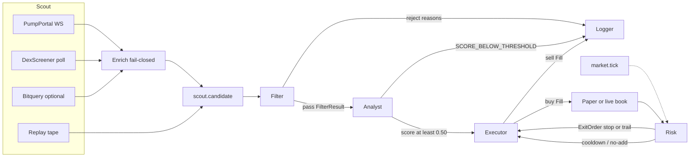

# Night Desk

Overnight Solana memecoin desk. Six agents, hard handoffs, paper ledger by default. Capital preservation is the product: a name that fails one safety check never reaches a ticket.

`npm install && npm run paper` boots the pipeline and the live terminal. The desk listens on `PORT` from `.env` (default 4721). Austin's machine uses `PORT=4788`.

Android `13.18` (versionCode 1318) keeps the 13.17 paper and live routing. Home opens on a one-line equity strip and a collapsed holdings list, so several coins fit on the screen. Details on a coin opens the PnL, entry, mark, stop, sparkline, paper 25/50/100, live buy and sell, orders and chart links. The one-tap size, slippage and Sell all sit in Settings. Search looks up a coin by name, symbol or mint without it already being on Home or the Tape. Home cards use smaller buttons with a 48dp touch target. A paper button always names the paper book. A live buy is only the LIVE button, and only after `operatorReady` is marked. An unknown wallet read shows as unknown, and a later failure keeps the last figure as stale. A live send whose confirmation times out keeps its signature and is not sent again.

This is a trading tool, not a promise of profit. Defaults are deliberately tight.

## Run paper mode

```bash
npm install
npm run paper
```

Paper mode does not need a private key, an RPC key, or `LIVE_TRADING`. A new book starts at **$100**. Orders fill against the last mark with a small slippage and fee model. The replay tape is on by default so the terminal is busy even when Pump.fun is quiet.

| Command | What it does |
| --- | --- |
| `npm run paper` | Fast path on Windows and Linux. Compiles `src` to `dist` when sources are newer, builds the UI only if `web/dist/index.html` is missing, then runs `node dist/index.js`. Replay tape on. Live trading off. |
| `npm run paper:live` | Same compiled process. Forces `DEMO_FEED=0` and `FEED_MODE=live`. Sets `LIVE_TRADING` only when `.env` says exactly `LIVE_TRADING=true` (manual live; AI stays paper unless "AI buys live" is on). |
| `npm run dev` | Same desk under `tsx` (no compile step). For editing TypeScript while it runs. |
| `npm test` | Filter, analyst, 8% cap, stop / trail / no-add |
| `npm run recap` | Morning recap of the last 12 hours |
| `npm run recap -- --since=24h` | Same recap, custom window (`30m`, `12h`, `7d`, `all`) |
| `./scripts/morning-recap.sh` | Same CLI via a shell wrapper |

`npm run paper` is the process to leave up. It does not rebuild the UI on every restart, and it does not stay on the `tsx` JIT. `npm run dev` is the TypeScript watch-style entry when you are changing `src`.

Enrichment runs DexScreener, the mint RPC, and RugCheck together, then the holder reads that depend on mint supply. `SCOUT_ENRICH_CONCURRENCY` defaults to 8 (clamped 1–16) and the drop queue defaults to 160. Those knobs change throughput, not the filter. A thin 1h volume still fetches mint, holders, and rug data so the kill reason stays accurate. Public RPC stays the default.

Live Scout keeps the Pump.fun websocket and also polls public HTTP lists. The same mint is enriched once. A second pass happens only when the first pass had no 1h volume and a later listing brought one. Poll intervals: DexScreener profiles and latest boosts every 20s, top boosts every 45s, community takeovers every 60s, GeckoTerminal new pools every 15s, GeckoTerminal trending every 30s, Jupiter recent tokens every 20s. Bitquery runs every 30s only when `BITQUERY_API_KEY` is set. None of those lists are required for the others. DexScreener 1h volume is the deepest pool's `h1`, or `h24` when the pool is younger than an hour and `h1` is still empty. A listing that already has volume fills the gap when the pair lookup is empty.

Useful overrides (see `.env.example`):

```bash
# Demo tape only. No public network calls.
FEED_MODE=replay npm run paper

# Live discovery only. Still paper. The tape can sit quiet if upstream is down.
DEMO_FEED=0 FEED_MODE=live npm run paper
# Same thing, and the script forces LIVE_TRADING=false.
npm run paper:live

# Wipe the open paper book on boot. Cash comes from PAPER_BALANCE_USD (default $100).
PAPER_RESET=1 npm run paper
```

**Reset book** on the Equity card (and on the Android Book screen) asks first, then does the same kind of wipe while the desk is running. It always sets cash and the session baseline to **$100**, drops open positions without sending an order, and clears revenge cooldowns plus the on-screen session chart. It keeps the append-only log (`desk.sqlite` events, `desk.jsonl`, `desk.log`), `data/advisor.json`, and the saved 1h volume floor. It refuses to run if the desk is actually live, and it does not turn live trading on. Last exits on the card show closes from the new session only. Older closes stay in the database for the morning recap.

```bash
curl -X POST http://127.0.0.1:4721/api/paper/reset \
  -H 'content-type: application/json' \
  -d '{"confirm":true}'
```

## Phone access

The desk binds `0.0.0.0:4721`. On home Wi‑Fi a phone can open `http://<lan-ip>:4721`. Away from home, put a tunnel in front and set a shared secret. Leave `LIVE_TRADING` unset or `false` unless you intentionally want real orders. A tunnel does not arm live trading.

```bash
# Paper book, live market prints, no replay tape. Pick a long random token.
LIVE_TRADING=false DEMO_FEED=0 FEED_MODE=live DESK_TOKEN='choose-a-long-secret' npm run paper
```

In another terminal, start the tunnel once and leave it running. Restarting Node does not mint a new hostname. `npm run tunnel` (or `scripts/ensure-tunnel.ps1` on Windows) starts `cloudflared` only when no tunnel already targets port 4721. It never kills an existing tunnel. On Windows, `scripts/redeploy-paper.ps1` stops the Node process listening on 4721 and leaves `cloudflared` alone.

```bash
npm run tunnel
# Windows: powershell -File scripts\ensure-tunnel.ps1
```

On Austin's desk folder `C:\Users\Austin\ndesk2`, a redeploy keeps `.env` and `data\` where they are. Restart the Node process that is listening on 4721. Do not stop `cloudflared`. `scripts\redeploy-paper.ps1` does that: it refuses to kill a cloudflared process, starts `npm run paper:live`, then runs `ensure-tunnel.ps1`, which leaves an existing tunnel in place. Copy the new source over the folder without replacing `.env`, `data\desk.sqlite`, `data\advisor.json`, or `data\public-url.txt`.

The script writes `data/public-url.txt`. To publish that URL for the phone, set these in the desk environment (do not commit them):

- `SUPABASE_URL` — optional, defaults to `https://qivqvwlrmrgjpiqgvmzy.supabase.co`
- `SUPABASE_SERVICE_ROLE_KEY` — required for the beacon PATCH. The anon key cannot write this row.
- `NIGHT_DESK_BEACON_ID` — optional, defaults to `phone`

Without the service-role key the script still writes `data/public-url.txt` and says the PATCH was skipped. The Android watcher reads `night_desk_beacon.public_url` with the public anon key, then a saved Link URL, then the desk's `/api/health` public URL. It does not guess port 4721. Set `PORT` in `.env` (Austin uses 4788) and point the tunnel at that port.

Open `https://<the-tunnel-host>/?token=choose-a-long-secret` on the phone. That first load sets an HttpOnly cookie so later asset and API requests stay authorized. You can also send `X-Desk-Token` or `?token=` on each call. A missing or wrong secret is **401**. With `DESK_TOKEN` unset, the desk behaves as a local open terminal.

Do not commit the token, do not paste it into the repo, and do not put it in a screenshot. Cloudflare and ngrok will see it on the first URL. Prefer a long random value over a word.

`npm run paper:live` is the same live-feed paper command without you having to remember `DEMO_FEED=0`. It still will not turn on `LIVE_TRADING`. Add `DESK_TOKEN` in the environment yourself before starting it behind a tunnel.

State lives in `data/desk.sqlite` (queryable), `data/desk.jsonl` (append-only mirror), and `data/desk.log` (plain text, one line per stage). The activity log in the terminal loads that history and keeps a live tail. Filter it by scout, filter, analyst, executor, risk, or system.

The advisor card is commentary. It learns win rate by volume, holder, and liquidity bucket into `data/advisor.json` after each close, and it can say consider selling, skip, or hold. With `OPENAI_API_KEY` unset it uses that file plus the live marks. A key only rewrites the wording. It never sends an order. The hard stop is still automatic. Take profit is the Close button. Each open row also has Chart, Birdeye, and Jupiter links that only open the mint in a browser. They do not send an order.

Select a mint on the activity tape and press **Buy**. Blank size uses the position cap (`planOrder`, 8% of equity clipped by cash). A size above that cap is refused. An open mint cannot be added to. Paper mode fills with `quotePaperBuy`. The same button calls the Jupiter live broker only when the desk process is already in live mode. The advisor cannot press it.

```bash
curl -X POST http://127.0.0.1:4721/api/positions/buy \
  -H 'content-type: application/json' \
  -d '{"mint":"THE_MINT","sizeUsd":25}'
```

Omit `sizeUsd` to buy the full cap. Add `-H "X-Desk-Token: $DESK_TOKEN"` when the desk is locked.

```bash
curl -X POST http://127.0.0.1:4721/api/positions/close \
  -H 'content-type: application/json' \
  -d '{"mint":"THE_MINT"}'
```

Add `-H "X-Desk-Token: $DESK_TOKEN"` when the desk is locked. A manual close does not ban the mint.

The Android watcher is `android/` (`com.dirk.nightdesk`). Point it at the same URL and token. Build and install steps are in [android/README.md](android/README.md). The phone browser on the tunnel still works.

The 1h volume floor starts at **$10,000** when nothing is saved. The rules card and the watcher both write `POST /api/settings` with `minVolume1hUsd`. The desk clamps it to $1,000–$500,000, stores it in the sqlite `settings` row, and the next Filter check uses it. `MIN_VOLUME_1H_USD` is only the boot default when that row is empty. A saved floor such as $1,000 wins on the next boot. `PAPER_RESET` does not clear it.

## What you should see in the first minute

The replay tape is labeled `replay` and loops about every 48 seconds:

| Name | What the desk does |
| --- | --- |
| RUGMINT | Filter kill · mint authority still active |
| LOCKLESS | Filter kill · LP not locked |
| WHALEBAG | Filter kill · top 10 over 35% |
| DRYCOIN | Filter kill · volume under $10k |
| SERIAL | Filter kill · deployer is on the rug list |
| QUIETCAT | Filter pass, analyst reject · score under 0.50 |
| NIGHTPEPE | Paper buy, then hard stop near −6%, then a revenge re-entry is refused |
| MOONKIT | Paper buy and a run higher. A pullback does not auto-sell. Close it from the book |
| STEADY | Paper buy and hold. A second buy is refused (no averaging down) |

Live Pump.fun and DexScreener sightings show up beside the tape when those feeds answer. New mints usually die in Filter. That is the point.

## Architecture

Each stage publishes a typed payload. The next stage subscribes to that topic and nothing earlier. Market ticks are a side input to Risk so open positions can be marked. A tick cannot open a trade.



Handoff types live in `src/types.ts`. Wiring is only in `src/desk/orchestrator.ts`.

| Edge | Payload | Receiver may |
| --- | --- | --- |
| `scout.candidate` | `CandidateToken` | Filter only |
| `filter.result` pass | `FilterResult` | Analyst only |
| `analyst.report` trade | `AnalystReport` | Executor buy only |
| `market.tick` | mint + price | Mark the book. Risk may hard-stop. Cannot open. |
| operator Buy | mint + optional size | Executor buy only. Same cap and no-add rules. Skips Filter and Analyst. |
| `risk.exit` | `ExitOrder` | Executor sell only |
| every result | `FeedEvent` | Logger appends SQLite, JSONL, and `data/desk.log` |

Unknown mint authority fails closed. A RugCheck report that never mentions mint authority does not count as revoked. LP is judged by the weakest market, and a silent market cannot vouch for the ones that report a lock. `lpLockedPct` is a percent: 1 and 0.96 are not full locks. Top-10 concentration is the higher of the chain read and RugCheck. A NaN concentration fails closed. On a Helius RPC the desk pages past the 20 largest accounts (`HOLDER_PAGES_MAX`, default 3) and sums by owner. A public RPC stays on the top 20.

Paper fills use constant-product slippage (buy `x/R`, sell `y/(R+y)`, R is half the pool). There is no 3% cap. Unknown liquidity pays the 50% ceiling. Fees round up and proceeds round down. Open positions are re-priced from the deepest DexScreener pool. Replay-tape mints are not sent there. A missing price is never invented. The hard stop is still the only automatic exit.

Unknown top-10 concentration fails closed when enrichment never returns holder rows. Unknown LP fails closed only after a pool exists. A Pump mint still on the bonding curve has no LP to lock, so that check is skipped. A verified unlocked or unburned LP still rejects. Top-10 math drops bonding-curve vaults, Raydium LP authorities, and the burn address before the 35% line (see the list in `src/market/exclusions.ts`). In this repo, “vault” means those pool and bonding-curve reserve accounts. Night Desk does not keep a user wallet vault, and it does not store a Phantom seed or private key. RugCheck `topHolders` is preferred when that list identifies reserves so they can be removed. A missing dev wallet does not count as a rug link. A known rug wallet, or a RugCheck creator-rug hint, does.

## Risk rules

You can tighten the capital rules with env vars. Looser values are ignored. The 1h volume floor is the exception: it moves at runtime inside $1,000–$500,000 and the saved value wins over the env on the next boot.

| Rule | Default | Enforcement |
| --- | --- | --- |
| Mint authority | Must be revoked | Filter `MINT_AUTHORITY_ACTIVE`. Unknown fails closed. |
| Top 10 holders | ≤ 35% of supply | Filter `HOLDER_CONCENTRATION`, after curve / LP vault / burn accounts are removed. Unknown with no holder rows fails closed. `MAX_TOP10_PCT` may tighten this. A looser value is ignored. |
| 1h volume | ≥ $10,000 until you change it | Filter `VOLUME_TOO_LOW`. The rules card and `POST /api/settings` set it from $1,000 to $500,000. Saved in the desk database. A saved $1,000 floor stays. |
| Rug deployer | Not on the local list or report hint | Filter `DEV_RUG_HISTORY` |
| Analyst score | ≥ 0.50 | Else `SCORE_BELOW_THRESHOLD`. `ANALYST_MIN_SCORE` may tighten this. A value under 0.50 is ignored. Pool depth is a score factor, not a hard kill. |
| Position size | 8% of equity, clipped by cash | Never more, even if `MAX_POSITION_PCT` is higher. Refused rather than oversized. |
| LP | Locked or burned once a pool exists | Filter `LP_NOT_LOCKED` when LP is verified unlocked. Skipped on a Pump bonding curve. Unknown LP off-curve still fails closed. |
| Hard stop | −6% from the fill | `STOP_LOSS`. The only automatic exit. Live marks on open mints keep it honest. |
| Take profit | Manual | `POST /api/positions/close` or the Close button. A winner is not sold by a trail. Peak is a hint. |
| Averaging down | Disabled | `NO_AVERAGE_DOWN` while the mint is open |
| Revenge trades | 6 hour ban after a hard stop | `REVENGE_COOLDOWN`. A manual close does not ban. |
| Live trading | Off | Requires `LIVE_TRADING=true` and `WALLET_KEYPAIR_PATH`. Anything else stays paper. |

Several names can be open at once. Each is capped at 8%. Gross exposure can therefore exceed 8%.

### Analyst score

Weights: liquidity 0.25, holders 0.25, volume 0.20, age 0.15, social 0.15.

- **Liquidity** — bands from under $15k (0.12) up to $250k+ (1.00).
- **Holders** — top-10 share inside the 20% gate, plus a small bonus for 400+ and 1,000+ holders.
- **Volume** — last-hour notional, with a haircut when volume is more than 20× liquidity.
- **Age** — under 10 minutes is hostile; 30 minutes to 6 hours scores highest.
- **Social** — website, telegram, twitter, mention count. A weak proxy. It cannot carry a thin pool over the line by itself.

## Feeds and env

Copy `.env.example` to `.env` only when you want overrides. No secrets ship in the repo.

| Variable | Purpose |
| --- | --- |
| `SOLANA_RPC_URL` | Mint authority and top accounts. Default public mainnet RPC. Set a Helius URL (`https://mainnet.helius-rpc.com/?api-key=…`) if you have one. |
| `PUMP_WS_URL` | PumpPortal new-token websocket. Default `wss://pumpportal.fun/api/data`. |
| `BITQUERY_API_KEY` | Optional. When set, Scout also polls Bitquery every 30s for recent Solana DEX buys. DexScreener, GeckoTerminal, and Jupiter recent do not need it. |
| `SCOUT_ENRICH_CONCURRENCY` | Parallel enrich workers. Default 8. Clamped to 1–16. |
| `RUGCHECK_API_URL` | Supplemental LP lock and creator-rug hints. Default public RugCheck. Failures do not crash the desk. |
| `RUG_WALLETS_FILE` | JSON `{ "wallets": { "<address>": "why" } }` merged into the rug registry. |
| `LIVE_TRADING` | Must be the exact string `true` or the desk stays paper. |
| `WALLET_KEYPAIR_PATH` | Solana CLI JSON keypair on the Austin desk host. Used only for live swaps. Never commit it. Never put it in the Android app. |
| `JUPITER_QUOTE_URL` / `JUPITER_SWAP_URL` | Live buys and sells only. Paper mode never calls them. |
| `DB_PATH` / `LOG_JSONL` | Ledger locations. |
| `PORT` | Terminal port. Default `4721`. |
| `DESK_TOKEN` | Optional. When set, pages, `/api/*`, and `/ws` require `X-Desk-Token` or `?token=`. Never commit it. |

Live discovery enriches each mint with DexScreener, then RPC, then RugCheck. If a check cannot be verified, Filter rejects it. Public RPC rate limits are real; a Helius-style URL is the practical upgrade.

The replay rug deployer `RugDev111…` is a fixture, not a mainnet wallet.

## Live trading

Leave it off until you mean it. The terminal and the Android watcher show a **Live ready** checklist: mode (`paper` or `live`), whether `LIVE_TRADING` is the exact string `true`, whether the keypair file is present on the desk host, and the public address when that file parses. The RPC URL is not shown. The phone can POST `{"operatorReady": true}` to `/api/live/ready` to mark the checklist. That mark is a note. It does not set `LIVE_TRADING`, does not change mode, and does not save a wallet.

Night Desk has no in-app vault for seeds or private keys. The only trading secret is the Solana CLI JSON file at `WALLET_KEYPAIR_PATH` on the Austin machine that runs the desk. “Vault” elsewhere in this repo means a bonding-curve or LP reserve account.

### Flip to real money later

Do this on Austin, in the desk folder, not from the phone:

1. Create a Solana CLI keypair outside the repo and outside the Android app. Example: `solana-keygen new -o C:\Users\Austin\ndesk2\secrets\id.json`. Do not commit that file. Do not paste the seed into Night Desk, the watcher, or chat.
2. Fund that wallet with USDC (Jupiter spends USDC) and a little SOL for fees.
3. Edit Austin `.env` (the phone cannot do this):
   ```bash
   LIVE_TRADING=true
   WALLET_KEYPAIR_PATH=C:\Users\Austin\ndesk2\secrets\id.json
   SOLANA_RPC_URL=https://mainnet.helius-rpc.com/?api-key=YOUR_KEY
   ```
   Keep `DEMO_FEED=0` if you want live Pump and Dex feeds. Leave the other hard rules as they are. The −6% stop stays. Winners still close only from the Close button.
4. Restart the Node process that listens on 4721 (`scripts\redeploy-paper.ps1` restarts the desk and leaves cloudflared up). A running process does not reread `.env` by itself.
5. Confirm the checklist: mode `live`, `LIVE_TRADING` true, keypair present, public address matches `solana-keygen pubkey` on that file. `armError` should be empty. If `LIVE_TRADING=true` but the key path is missing, the process still boots **in paper** and the banner says so.
6. Buy and Close stay the same buttons. In live mode they send Jupiter swaps. In paper mode they never do.

To go back to paper, set `LIVE_TRADING=false` (or remove it), restart the desk, and confirm the lamp says PAPER. The checklist mark can stay on; it still does not arm trading.

## Overnight

[pm2](ecosystem.config.cjs):

```bash
npm install
npx pm2 start ecosystem.config.cjs
npx pm2 logs night-desk
```

systemd: `deploy/solana-desk.service`. Edit `WorkingDirectory` and the `node` path, then:

```bash
sudo cp deploy/solana-desk.service /etc/systemd/system/
sudo systemctl enable --now solana-desk
```

Docker:

```bash
docker compose up --build
```

The container publishes port 4721, restarts unless stopped, and keeps the ledger in the `desk-data` volume. `LIVE_TRADING` is hardcoded false in the compose file.

Morning recap (cron example, 13:05 UTC):

```bash
5 13 * * * cd /opt/night-desk && ./scripts/morning-recap.sh --since=12h >> /var/log/night-desk-recap.log 2>&1
```

The recap includes equity change, closed trades, biggest win and loss, open marks, filter kill counts by reason, analyst rejects, executor skips, and risk exits. The same report is on the terminal via **Morning recap** and `GET /api/recap?since=12h`.

## Layout

```
src/types.ts                 handoff payloads
src/rules.ts                 hard floors and clamps
src/bus.ts                   in-process handoff bus
src/agents/scout.ts          PumpPortal, DexScreener, optional Bitquery, replay door
src/agents/filter.ts         hard rejects
src/agents/analyst.ts        0.0–1.0 score
src/agents/execution-math.ts 8% cap and paper slippage
src/agents/risk.ts           stop, trail, no-add, cooldown
src/market/live-broker.ts    Jupiter swap, imported only when a live order fires
src/desk/orchestrator.ts     the only place stages are wired
src/store/db.ts              SQLite + JSONL
src/cli/recap.ts             morning recap
web/                         terminal UI
android/                     watcher (Kotlin, Jetpack Compose)
```

## Tests

```bash
npm test
```

Covers every filter rule (including fail-closed nulls and the all-rules rejection), the runtime 1h volume floor (boot default $10k, then the next check uses the saved line), the 0.50 analyst line, the 35% top-10 cap, the 8% cap (including a widened rule that still clips), the −6% stop, the +12% / 4% trail hint, no averaging down, the revenge ban, the scout → filter → analyst → executor order, enrich overlap (Dex + mint + RugCheck, then holders), the enrich concurrency cap, and the token gate against a fixture UI so a missing `web/dist` is not a 503 flake.
