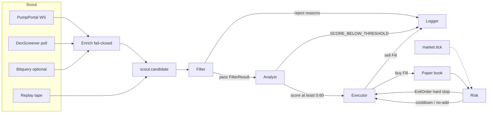

# Night Desk

Overnight Solana memecoin desk. Six agents, hard handoffs, paper ledger by default. Capital preservation is the product: a name that fails one safety check never reaches a ticket, the hard stop can only tighten, the advisor only advises, and the math fails closed.

**v13.12.** Android application id `com.dirk.nightdesk`, `versionName` 13.12, `versionCode` 1312. That release adds after-slippage **net** P&L and a live sparkline on every open position, on the web book and the Android Book card.

This is a trading tool, not a promise of profit. Defaults are deliberately tight.

The commercial ideas in [docs/ROADMAP.md](docs/ROADMAP.md) are a plan only. They are not implemented and they are not enabled on this private desk.

## What v13.12 shows

Open positions (web and Android) show two P&L numbers and a small chart:

- **Mark** is raw mark-to-market: `qty × mark − cost`. Equity, the 8% cap, and the hard stop still use this mark.
- **Net** is what a close would clear after the desk’s existing sell slippage and fee. It uses the same paper sell quote the executor already fills with. There is no second slippage constant.
  - Exit slippage = `baseSlippage` (0.15%) + constant-product sell impact. Reported liquidity is the whole pool; impact is measured against one side (`poolSideShare` 0.5). The rate is capped at `maxSlippage` (50%).
  - Unknown but numeric liquidity pays that 50% ceiling. A non-finite liquidity figure is missing, not zero.
  - Proceeds = the post-slip fill minus the paper fee (10 bps). Fees round up. Proceeds round down.
  - Net = proceeds − cost. Cost is the cash already spent, so the worse buy fill and the buy fee are inside the number. When the fill stored a buy slippage rate, the card shows it as already in the cost.
  - A missing mark, a missing mark time, a non-finite input, or a mark older than 5 minutes (the same silence window as the position pricer) shows **`net —`** or **`net — stale mark`**. The card does not invent a profit.
- **Sparkline** is a compact price line for that coin. The book keeps up to 64 recent marks per held mint, fed by the existing mark loop (scout, replay, and the DexScreener position pricer). There is no extra chart poll. The series is saved with the book so a restart keeps the line. The last point’s time is the freshness stamp for net. Phone-width web rows stack so the chart and the net line stay readable. Chart, Birdeye, and Jupiter links are still on the card. Those links only open a browser. They do not send an order.

A real live close still goes through Jupiter. The net line is this model, not a fresh Jupiter quote.

Also on the desk today:

- Activity tape with stage filters. Scout lines carry the mark. Open positions carry the live mark, mark P&L, and net.
- Morning recap on the terminal, `npm run recap`, and `GET /api/recap`.
- Advisor card. It can say sell, skip, hold, or watch. It never sends an order.
- 1h volume floor, edited from the rules card or the Android book (`POST /api/settings`).
- Reset book, back to $100, paper only.
- Manual close (`POST /api/positions/close` or the Close button). A manual close does not ban the mint.

Dirk’s Austin desk is also operated with these controls. They are part of the product surface he runs. They are not routes in this commit’s `src/server/http.ts`, and they are not on the Compose screens in this tree: one-tap live buy and live sell beside each paper position; limit, stop, and take-profit orders on paper and live, with an Orders list and a take-profit cap up to 600%; adjustable per-trade live size; adjustable max slippage; light and dark theme; paste-any-coin paper buy; watchlist. The watcher sources here save the desk URL on the Link screen. They do not yet read `data/public-url.txt` or a “Hold this URL” switch. Treat that list as the operator runbook, and confirm the build on the PC before relying on a control this commit does not serve.

“AI buys live too” stays off. Automated entries stay on the paper book.

## Run it

```bash
npm install
npm run paper
```

Paper mode does not need a private key, an RPC key, or `LIVE_TRADING`. A new book starts at **$100**. Orders fill against the last mark with the slippage and fee model above. The replay tape is on by default so the terminal is busy even when Pump.fun is quiet. The code default listen address is `0.0.0.0:4721` (`HOST`, `PORT`).

| Command | What it does |
| --- | --- |
| `npm run paper` | Compiles `src` to `dist` when sources are newer, builds the UI only if `web/dist/index.html` is missing, then runs `node dist/index.js`. Replay tape on. Live trading off. |
| `npm run paper:live` | Same compiled process. Forces `DEMO_FEED=0`, `FEED_MODE=live`, and `LIVE_TRADING=false` for the child, so a `LIVE_TRADING=true` in `.env` does not arm this process. |
| `npm run dev` | Same desk under `tsx`. For editing TypeScript while it runs. |
| `npm test` | Vitest. Filter, analyst, cap, stops, slippage, net P&L, sparklines, token gate. |
| `npm run recap` | Morning recap of the last 12 hours. |
| `npm run recap -- --since=24h` | Same recap, custom window (`30m`, `12h`, `7d`, `all`). |
| `./scripts/morning-recap.sh` | Same CLI via a shell wrapper. |

`npm run paper` is the process to leave up on a dev machine. It does not rebuild the UI on every restart. `npm run dev` is the TypeScript entry when you are changing `src`.

Enrichment runs DexScreener, the mint RPC, and RugCheck together, then the holder reads that depend on mint supply. `SCOUT_ENRICH_CONCURRENCY` defaults to 6 (clamped 1–12) and the drop queue defaults to 160. Those knobs change throughput, not the filter. A thin 1h volume still fetches mint, holders, and rug data so the kill reason stays accurate. Public RPC stays the default; raise concurrency only when `SOLANA_RPC_URL` is a private endpoint.

```bash
# Demo tape only. No public network calls.
FEED_MODE=replay npm run paper

# Live discovery, still paper, without the launcher override.
DEMO_FEED=0 FEED_MODE=live npm run dev

# Wipe the open paper book on boot. Cash comes from PAPER_BALANCE_USD (default $100).
PAPER_RESET=1 npm run paper
```

**Reset book** on the Equity card (and on the Android Book screen) asks first, then wipes the open paper book while the desk is running. It sets cash and the session baseline to **$100**, drops open positions without sending an order, and clears revenge cooldowns plus the on-screen session chart. It keeps the append-only log (`desk.sqlite` events, `desk.jsonl`, `desk.log`), `data/advisor.json`, and the saved 1h volume floor. It refuses to run if the desk is actually live, and it does not turn live trading on. Last exits on the card show closes from the new session only. Older closes stay in the database for the morning recap.

```bash
curl -X POST http://127.0.0.1:4721/api/paper/reset \
  -H 'content-type: application/json' \
  -d '{"confirm":true}'
```

Use the port the process is actually bound to. On Austin that is **4788** (see below).

## Austin

The desk Dirk leaves up runs on the Windows PC **Austin**, checkout `C:\Users\Austin\ndesk2`.

Two Windows scheduled tasks keep it alive:

| Task | Script |
| --- | --- |
| `NightDesk-KeepAlive-Desk` | `scripts/ensure-desk.ps1` |
| `NightDesk-KeepAlive-Tunnel` | `scripts/ensure-tunnel.ps1` |

The desk task starts `npm run paper:live` in that checkout (live feeds, replay tape off, and the launcher forces `LIVE_TRADING=false`). The tunnel task runs a Cloudflare **quick tunnel** (`trycloudflare.com`). When the tunnel dies, the keepalive starts it again. The current hostname is written to `data/public-url.txt` on that PC. That file is gitignored. Do not commit it, do not paste the hostname into the repo, and do not put it in a screenshot.

The phone reaches the desk through that tunnel. The Android app is meant to follow `data/public-url.txt` unless **Hold this URL** is on. The Link screen in this repository’s watcher still stores the base URL and token you save on the phone.

Those two PowerShell scripts are what the scheduled tasks call on Austin. They are not in this commit. Clone the repo and the tasks will not appear until those scripts exist on the PC.

### Port 4721 was hijacked

The desk’s code default is port **4721**. On Austin it currently runs with `PORT=4788`.

What happened: Windows `wslrelay.exe` bound **4721** and answered **HTTP 401** on everything. The Cloudflare tunnel and the keepalive health checks were talking to that relay, not to Night Desk, and the tunnel went down.

Fix, already applied on Austin:

1. Pick a free port. Austin uses `PORT=4788` in `.env` (never commit `.env`).
2. Point `cloudflared` at `http://127.0.0.1:4788`.
3. Point the keepalive health checks at that same port.
4. Leave `wslrelay.exe` on 4721 alone. Do not point the tunnel back at 4721 while the relay still owns it.

The process still accepts `HOST` (default `0.0.0.0`). The tunnel should target loopback on the free port, not the relay.

## Phone and Android

Build and install notes: [android/README.md](android/README.md).

- Package `com.dirk.nightdesk`, versionCode **1312**, versionName **13.12**.
- Book cards show mark P&L, net, the sparkline, the hard stop, chart links, and Close.
- Away from home, open the hostname in `data/public-url.txt`. Do not copy that hostname into git.
- If `DESK_TOKEN` is set, the first page load with `?token=` sets an HttpOnly cookie. You can also send `X-Desk-Token`. A missing or wrong secret is **401**. With `DESK_TOKEN` unset, the desk is a local open terminal. Never commit the token.

```bash
curl -X POST http://127.0.0.1:4788/api/positions/close \
  -H 'content-type: application/json' \
  -d '{"mint":"THE_MINT"}'
```

Add `-H "X-Desk-Token: $DESK_TOKEN"` when the desk is locked.

State lives in `data/desk.sqlite`, `data/desk.jsonl`, and `data/desk.log`. The tape loads that history and keeps a live tail. Filter it by scout, filter, analyst, executor, risk, or system.

The 1h volume floor starts at **$50,000**. The desk clamps a new value to $1,000–$500,000, stores it in the sqlite `settings` row, and the next Filter check uses it. `MIN_VOLUME_1H_USD` is only the boot default when that row is empty. `PAPER_RESET` does not clear it.

## What you should see in the first minute

The replay tape (`npm run paper`, not `paper:live`) is labeled `replay` and loops about every 48 seconds:

| Name | What the desk does |
| --- | --- |
| RUGMINT | Filter kill · mint authority still active |
| LOCKLESS | Filter kill · LP not locked |
| WHALEBAG | Filter kill · top 10 over 20% |
| DRYCOIN | Filter kill · volume under $50k |
| SERIAL | Filter kill · deployer is on the rug list |
| QUIETCAT | Filter pass, analyst reject · score under 0.60 |
| NIGHTPEPE | Paper buy, then hard stop near −6%, then a revenge re-entry is refused |
| MOONKIT | Paper buy and a run higher. A pullback does not auto-sell. Close it from the book |
| STEADY | Paper buy and hold. A second buy is refused (no averaging down) |

On an open name the row shows mark P&L, a smaller net, and a sparkline that moves as the tape reprints. `npm run paper:live` does not play this tape. Live Pump.fun and DexScreener sightings show up when those feeds answer. New mints usually die in Filter.

## Architecture

Each stage publishes a typed payload. The next stage subscribes to that topic and nothing earlier. Market ticks mark the book. A tick cannot open a trade.



Handoff types live in `src/types.ts`. Wiring is only in `src/desk/orchestrator.ts`.

| Edge | Payload | Receiver may |
| --- | --- | --- |
| `scout.candidate` | `CandidateToken` | Filter only |
| `filter.result` pass | `FilterResult` | Analyst only |
| `analyst.report` trade | `AnalystReport` | Executor buy only |
| `market.tick` | mint + price | Mark the book and append the sparkline. Risk may hard-stop. Cannot open. |
| `risk.exit` | `ExitOrder` | Executor sell only |
| every result | `FeedEvent` | Logger appends SQLite, JSONL, and `data/desk.log` |

Unknown mint authority fails closed. A RugCheck report that never mentions mint authority does not count as revoked. LP is judged by the weakest market, and a silent market cannot vouch for the ones that report a lock. `lpLockedPct` is a percent: 1 and 0.96 are not full locks. Top-10 concentration is the higher of the chain read and RugCheck. A NaN concentration fails closed. On a Helius RPC the desk pages past the 20 largest accounts (`HOLDER_PAGES_MAX`, default 3) and sums by owner. A public RPC stays on the top 20.

Paper fills use constant-product slippage (buy `x/R`, sell `y/(R+y)`, R is half the pool). Unknown liquidity pays the 50% ceiling. Fees round up and proceeds round down. Open positions are re-priced from the deepest DexScreener pool. Replay-tape mints are not sent there. A missing price is never invented. Net P&L is withheld when that mark is stale. The hard stop is still the only automatic exit. Peak is a hint, not an order.

Unknown top-10 concentration fails closed when enrichment never returns holder rows. Unknown LP fails closed only after a pool exists. A Pump mint still on the bonding curve has no LP to lock, so that check is skipped. A verified unlocked or unburned LP still rejects. Top-10 math drops bonding-curve vaults, Raydium LP authorities, and the burn address before the 20% line (see `src/market/exclusions.ts`). RugCheck `topHolders` is preferred when that list identifies reserves so they can be removed. A missing dev wallet does not count as a rug link. A known rug wallet, or a RugCheck creator-rug hint, does.

## Risk rules

You can tighten the capital rules with env vars. Looser values are ignored. The 1h volume floor is the exception: it moves at runtime inside $1,000–$500,000 and the saved value wins over the env on the next boot.

| Rule | Default | Enforcement |
| --- | --- | --- |
| Mint authority | Must be revoked | Filter `MINT_AUTHORITY_ACTIVE`. Unknown fails closed. |
| Top 10 holders | ≤ 20% of supply | Filter `HOLDER_CONCENTRATION`, after curve / LP vault / burn accounts are removed. Unknown with no holder rows fails closed. |
| 1h volume | ≥ $50,000 until you change it | Filter `VOLUME_TOO_LOW`. The rules card and `POST /api/settings` set it from $1,000 to $500,000. Saved in the desk database. |
| Rug deployer | Not on the local list or report hint | Filter `DEV_RUG_HISTORY` |
| Analyst score | ≥ 0.60 | Else `SCORE_BELOW_THRESHOLD`. Pool depth is a score factor, not a hard kill. |
| Position size | 8% of equity, clipped by cash | Never more, even if `MAX_POSITION_PCT` is higher. Refused rather than oversized. |
| LP | Locked or burned once a pool exists | Filter `LP_NOT_LOCKED` when LP is verified unlocked. Skipped on a Pump bonding curve. Unknown LP off-curve still fails closed. |
| Hard stop | −6% from the fill | `STOP_LOSS`. The only automatic exit. Env may only tighten it. |
| Take profit | Manual in this tree | Close button or `POST /api/positions/close`. A winner is not sold by a trail. The Austin runbook’s take-profit orders cap at 600%; this commit does not place those orders. |
| Averaging down | Disabled | `NO_AVERAGE_DOWN` while the mint is open |
| Revenge trades | 6 hour ban after a hard stop | `REVENGE_COOLDOWN`. A manual close does not ban. |
| Live trading | Off for `npm run paper` and `npm run paper:live` | See below. Automated buys stay paper. |

Several names can be open at once. Each is capped at 8%. Gross exposure can therefore exceed 8%.

### Analyst score

Weights: liquidity 0.25, holders 0.25, volume 0.20, age 0.15, social 0.15.

- **Liquidity** — bands from under $15k (0.12) up to $250k+ (1.00).
- **Holders** — top-10 share inside the 20% gate, plus a small bonus for 400+ and 1,000+ holders.
- **Volume** — last-hour notional, with a haircut when volume is more than 20× liquidity.
- **Age** — under 10 minutes is hostile; 30 minutes to 6 hours scores highest.
- **Social** — website, telegram, twitter, mention count. A weak proxy. It cannot carry a thin pool over the line by itself.

## Feeds and env

Copy `.env.example` to `.env` only when you want overrides. No secrets ship in the repo. Austin’s `.env` stays on that PC.

| Variable | Purpose |
| --- | --- |
| `SOLANA_RPC_URL` | Mint authority and top accounts. Default public mainnet RPC. Set a Helius URL (`https://mainnet.helius-rpc.com/?api-key=…`) if you have one. |
| `PUMP_WS_URL` | PumpPortal new-token websocket. Default `wss://pumpportal.fun/api/data`. |
| `BITQUERY_API_KEY` | Optional. When set, Scout also polls Bitquery for recent Solana DEX buys. |
| `RUGCHECK_API_URL` | Supplemental LP lock and creator-rug hints. Default public RugCheck. Failures do not crash the desk. |
| `RUG_WALLETS_FILE` | JSON `{ "wallets": { "<address>": "why" } }` merged into the rug registry. |
| `LIVE_TRADING` | Must be the exact string `true` or the desk stays paper. `npm run paper:live` overwrites this to `false`. |
| `WALLET_KEYPAIR_PATH` | What this repository’s live broker reads: a Solana CLI JSON keypair file. Never commit the file. |
| `WALLET_PRIVATE_KEY` | The name of the wallet secret in Austin’s `.env`. This tree’s broker does not read it. Never commit the value. |
| `JUPITER_QUOTE_URL` / `JUPITER_SWAP_URL` | Live buys and sells only. Paper mode never calls them. Jupiter slippage tolerance in this broker is 100 bps. |
| `DB_PATH` / `LOG_JSONL` | Ledger locations. |
| `PORT` | Terminal port. Code default `4721`. Austin `.env` is `4788`. |
| `HOST` | Bind address. Code default `0.0.0.0`. Point the tunnel at `127.0.0.1` and `PORT`. |
| `DESK_TOKEN` | Optional. When set, pages, `/api/*`, and `/ws` require `X-Desk-Token` or `?token=`. Never commit it. |

Live discovery enriches each mint with DexScreener, then RPC, then RugCheck. If a check cannot be verified, Filter rejects it. Public RPC rate limits are real; a Helius-style URL is the practical upgrade.

The replay rug deployer `RugDev111…` is a fixture, not a mainnet wallet.

## Live trading

Manual live buys and sells are the only live path. The agents stay on the paper book. There is no switch that lets the AI buy live, and that stays off.

`npm run paper` and `npm run paper:live` both force the child to `LIVE_TRADING=false`. Austin’s keepalive uses `paper:live`, so the process those tasks supervise does not arm Jupiter even if `.env` contains `LIVE_TRADING=true`.

To arm a process for manual live swaps you need all of:

1. `LIVE_TRADING=true` in the environment of that process (not overwritten by `scripts/start-paper.mjs --live`).
2. A wallet secret that is not in git. Austin stores it as `WALLET_PRIVATE_KEY` in `.env`. This repository’s broker loads a Solana JSON keypair from `WALLET_KEYPAIR_PATH` and logs the public key only.
3. `SOLANA_RPC_URL` that can send transactions.
4. USDC in that wallet (Jupiter input) and a little SOL for fees.

If `LIVE_TRADING=true` but `WALLET_KEYPAIR_PATH` is missing, this tree still boots **in paper** and the terminal shows a banner. Docker Compose hardcodes `LIVE_TRADING=false`.

## Overnight on a Linux host

Austin uses the scheduled tasks above, not pm2. These still work elsewhere.

[pm2](ecosystem.config.cjs):

```bash
npm install
npx pm2 start ecosystem.config.cjs
npx pm2 logs night-desk
```

systemd: `deploy/solana-desk.service`. Edit `WorkingDirectory` and the `node` path, then:

```bash
sudo cp deploy/solana-desk.service /etc/systemd/system/
sudo systemctl enable --now solana-desk
```

Docker:

```bash
docker compose up --build
```

The container publishes port 4721, restarts unless stopped, and keeps the ledger in the `desk-data` volume. `LIVE_TRADING` is hardcoded false in the compose file. Do not publish 4721 on Austin while `wslrelay.exe` owns it.

Morning recap (cron example, 13:05 UTC):

```bash
5 13 * * * cd /opt/night-desk && ./scripts/morning-recap.sh --since=12h >> /var/log/night-desk-recap.log 2>&1
```

The recap includes equity change, closed trades, biggest win and loss, open marks, filter kill counts by reason, analyst rejects, executor skips, and risk exits. The same report is on the terminal via **Morning recap** and `GET /api/recap?since=12h`.

## Layout

```
src/types.ts                 handoff payloads, including net P&L fields
src/rules.ts                 hard floors and clamps
src/bus.ts                   in-process handoff bus
src/agents/scout.ts          PumpPortal, DexScreener, optional Bitquery, replay door
src/agents/filter.ts         hard rejects
src/agents/analyst.ts        0.0–1.0 score
src/agents/execution-math.ts 8% cap, paper slippage, realizable net
src/agents/risk.ts           stop, trail hint, no-add, cooldown
src/market/live-broker.ts    Jupiter swap, imported only when a live order fires
src/desk/book.ts             cash, marks, 64-point sparkline
src/desk/orchestrator.ts     the only place stages are wired
src/store/db.ts              SQLite + JSONL
src/cli/recap.ts             morning recap
web/                         terminal UI
android/                     watcher (Kotlin, Jetpack Compose), v13.12
docs/ROADMAP.md              commercial plan, not enabled
```

## Tests

```bash
npm test
```

Covers every filter rule (including fail-closed nulls and the all-rules rejection), the runtime 1h volume floor (default $50k, then the next check uses the saved line), the 0.60 analyst line, the 8% cap (including a widened rule that still clips), the −6% stop, the +12% / 4% trail hint, no averaging down, the revenge ban, the scout → filter → analyst → executor order, enrich overlap (Dex + mint + RugCheck, then holders), the enrich concurrency cap, after-slippage net (including stale and missing marks), the sparkline cap, and the token gate against a fixture UI so a missing `web/dist` is not a 503 flake.
